# delivery-skills

Claude Code skills for building with subagents while a human stays in
charge. Agents plan with you, build one small chunk at a time, prove each
chunk works, and stop so you can read the diff. Nothing is committed for you.

## Install

```
/plugin marketplace add vilkoalexander/delivery-skills
/plugin install delivery-skills@vilkoalexander
```

Skills show up as `delivery-skills:<name>`. Three agents come along:
`reviewer` and `verifier` (read-only) and `oneway-implementer`. The pipeline
dispatches them; you never call them.

## A run

1. **Grill the plan.** Every decision the planner made without you comes
   back as a numbered question with a recommended answer. Facts the agent
   can look up, it looks up. Your answers go into the plan file.
2. **Approve the cut.** The plan is split into chunks you can read in one
   sitting. Each has a risk class (low, medium, high) and one request or tap
   that proves it works.
3. **Build a chunk.** One implementer per task. Then the toolchain:
   typecheck, lint, related tests, and a check that new tests fail when the
   change is reverted. Failures go back to the implementer.
4. **Review and verify.** A reviewer reads the diff against the rubric for
   each file. A verifier runs the chunk and re-runs every claim in the
   implementer's proof; a claim it cannot reproduce fails. Low-risk chunks
   skip both; you read those yourself.
5. **Read the report.** Which files need a close read, what changed, what
   ran, what was verified, what was fixed, what was left.
6. **Say** `next`, `fix <thing>`, `redo` or `stop`. On a big chunk, `map`
   gives a page that walks the files in reading order.
7. **After the last chunk**, the verifier runs every acceptance criterion
   over the whole tree, a reviewer reads the tree against them, then a
   second model family reads it too.



Risk class comes from what a change touches, not how hard it looks.

| Class | Touches | Implementer | Review | Verify | Fix rounds | Second model |
| --- | --- | --- | --- | --- | --- | --- |
| low | feature-local UI, tests, docs | Haiku | none | none | 0 | no |
| medium | services, shared helpers, data fetching | Haiku or Sonnet | Sonnet | Sonnet | 3 | no |
| high | schema, auth, money, shared contracts | Opus | Opus | Sonnet | 5 | yes |



## Skills

| Skill | Does |
| --- | --- |
| `delivery-pipeline` | Settings: model per role, risk classes, the static gate, what a report must prove. |
| `chunked-delivery` | The loop above. |
| `review-routing` | Maps changed files to the rubrics below; merges findings into one list. |
| `react-review` | Reviews one React or React Native component. |
| `angular-review` | Reviews one Angular component, directive or pipe. |
| `nestjs-service-review` | Reviews one NestJS service, controller, guard or module. |
| `prisma-schema-review` | Reviews a Prisma model or migration. |
| `api-contract-review` | Reviews a change to a shared schema, DTO or type package. |
| `test-review` | Reviews a test file: can it fail? |
| `observability-review` | Reviews a backend file: can it be debugged in production? |
| `react-screen-authoring` | Read before a new screen is written. Container, view and builder split. |
| `comment-cleanup` | Removes comments a reader does not need. Proves only comment lines changed. |
| `reuse-guardrails` | Audits whether the project stops agents rewriting what already exists. Installs the checks you name. |
| `memory-dash` | Dashboard and audit of Claude Code auto-memory across projects. |

Each review rubric is a checklist, a list of things it must not report, and
two scripts: one scans a file for mechanical smells, one lists what the repo
already has. Zero findings is a valid result.





## Your project

- Tell the rubrics about your codebase: one file per rubric at
  `docs/review/<rubric>.md`. Starting points in [`templates/`](templates/README.md).
- `bash scripts/static-gate.sh coverage` lists which analyzers you enforce
  and which you lack. `STATIC-SETUP.md` in delivery-pipeline has the strict
  setup for each gap. What lint enforces never reaches a reviewer.
- `bash skills/reuse-guardrails/scripts/audit.sh <repo>` lists which of the
  thirteen reuse guardrails you have.
- `bash scripts/token-budget.sh` shows what each dispatch loads.
- Set `TYPESAFE_API_KEY` and `risk.sh` classifies from the diff content, not
  only from paths. Classes are only ever raised.

## Hooks

The plugin installs one hook. It wakes when a run starts (`run.sh start`, done
at preflight) and sleeps at handoff (`run.sh stop`). While awake it refuses,
with the reason printed:

- any git write from the session or a subagent: commit, add, push, merge,
  stash, reset --hard, checkout --, gh pr create. `git add -N` and
  `git apply -R` stay allowed; the snapshots need them.
- the controller reading a chunk snapshot.
- an implementer stopping without the Proof block it was asked for.

Reviewer and verifier seats are refused writes always. Outside a run the hook
does nothing, so other plugins that commit keep working. Tests:
`bash hooks/guard.test.sh`.

## License

MIT
