# delivery-skills

Claude Code skills for building with subagents while you stay the one who
accepts the code. You bring the idea and make the decisions. Agents turn it
into a plan, build one small chunk at a time, and stop so you can read the
diff. Nothing is committed for you.

| Who | Does |
| --- | --- |
| You | The idea, every decision, the final read of each diff |
| Agents | Edge cases as questions, the code, a first review, running the change |
| Scripts | Everything that has one right answer |

## Install

```
/plugin marketplace add vilkoalexander/delivery-skills
/plugin install delivery-skills@vilkoalexander
```

Skills show up as `delivery-skills:<name>`. Start a run by asking for a plan
to be built in chunks.

## A run

1. **Answer the questions.** Every decision the plan made without you comes
   back numbered, with a recommended answer. Facts the agent can look up, it
   looks up.
2. **Approve the cut.** Chunks you can read in one sitting, each with a risk
   class, the criteria it completes and the one request or tap that proves it.
3. **A chunk is built.** Scripts check it first. Then a reviewer reads it
   against the rubrics and a verifier runs it. Failures go back to the
   implementer, up to a cap.
4. **Read the report and the diff.** Which files need a close read, what was
   run, what was fixed, what was left. Say `next`, `fix <thing>`, `redo` or
   `stop`.
5. **After the last chunk** the whole tree is verified against every
   acceptance criterion, reviewed, then read by a second model family.

Agent review is a filter inside the build loop. Your read is the acceptance.



## Scripts decide what they can

A rule in a prompt is a request. A script gives the same answer every run,
costs no tokens and cannot be argued with. So anything with one right answer
is a script, and a model is asked only what is left.

| Script | Decides | Runs |
| --- | --- | --- |
| `hooks/guard.sh` | No commit, add, push, merge, stash or PR during a run. Reviewer and verifier cannot write. An implementer report has its Proof block. | On every tool call |
| `delivery-pipeline/scripts/static-gate.sh check` | Typecheck, lint, format and related tests pass | After each chunk, before any reviewer |
| `test-review/scripts/test-lock.sh` | No existing test was deleted, skipped or had an assertion rewritten | In the gate |
| `delivery-pipeline/scripts/drift.sh` | Two copies of one fact still agree: schema and migrations, API and generated client, native deps and SDK. You declare the pairs. | In the gate, when a matching path changed |
| `test-review/scripts/revert-check.sh` | New tests fail when the change is reverted | In the gate, when tests changed |
| `reuse-guardrails/scripts/reuse-scan.sh` | A new helper, export or dependency duplicates one the repo has | In the gate; flags, never fails |
| `delivery-pipeline/scripts/risk.sh` | Risk class of a change, from its paths | At the cut and in each report |
| `<rubric>/scripts/scan.sh` | Mechanical smells in one file | Before a reviewer reads it |
| `<rubric>/scripts/inventory.sh` | What the repo already has to reuse | Before an implementer writes |
| `chunked-delivery/scripts/redo.sh` | Returns the tree to before a chunk, keeps what it discards | On `redo` |
| `hooks/emit.sh` | Nothing: records every tool call, agent start and stop, and refusal of a run, in the background | On every tool call during a run |
| `chunked-delivery/scripts/mark.sh` | Which chunk and step the run is on, the one fact nothing else can observe | At each step of the loop |
| `chunked-delivery/scripts/run-log.sh` | One line per chunk; `stats` totals what each gate caught | At each decision |
| `comment-cleanup/scripts/verify.sh` | A cleanup changed comment lines only | After a comment cleanup |

Paths are under `skills/`. Outside a run the hook does nothing, so other
plugins that commit keep working. The scripts with logic worth breaking have
tests, run in CI: `guard`, `emit`, `event`, `test-lock`, `drift`, `run-log`,
`redo`, `risk-content`, `factory-floor`.

No script decides whether the design is right or the code will age well. That
is the reviewer's first pass and then yours, which is why chunks are small.

## Risk class

Risk comes from what a change touches, not how hard it looks.

| Class | Touches | Implementer | Review | Verify | Fix rounds | Second model |
| --- | --- | --- | --- | --- | --- | --- |
| low | feature-local UI, tests, docs | Haiku | none | none | 0 | no |
| medium | services, shared helpers, data fetching | Haiku or Sonnet | Sonnet | Sonnet | 3 | no |
| high | schema, auth, money, shared contracts | Opus | Opus | Sonnet | 5 | yes |

Low-risk chunks pass the scripts and go straight to you. The last fix round
goes to the next model up.

## Skills

| Skill | Does |
| --- | --- |
| `chunked-delivery` | The loop above, a long-run mode that stops only when it must, and the run log. |
| `delivery-pipeline` | Settings: model per role, risk classes, the static gate, what a report must prove. |
| `review-routing` | Maps changed files to rubrics; merges findings into one list. |
| `react-review`, `angular-review`, `nestjs-service-review`, `prisma-schema-review`, `api-contract-review`, `test-review`, `observability-review` | Review rubrics, one kind of file each: a checklist, a list of things not to report, a scan script and an inventory script. |
| `react-screen-authoring` | Read before a new screen is written. |
| `comment-cleanup` | Removes comments a reader does not need. |
| `reuse-guardrails` | Audits whether the project stops agents rewriting what already exists. |
| `memory-dash` | Dashboard and audit of Claude Code auto-memory across projects. |
| `factory-floor` | Local page that shows a run live: stations, gate steps, agents, tokens, refusals. |

Three agents come along: `reviewer` and `verifier` (read-only) and
`oneway-implementer`. The pipeline dispatches them. More diagrams in
[`diagrams/`](diagrams).

## Your project

- Tell the rubrics about your codebase: one file per rubric at
  `docs/review/<rubric>.md`. Starting points in [`templates/`](templates/README.md).
- `bash skills/delivery-pipeline/scripts/static-gate.sh coverage` lists which
  analyzers you enforce and which you lack. What lint enforces never reaches
  a reviewer.
- Declare your drift checks in `docs/review/drift.checks`, one line each;
  start from [`templates/drift.checks`](templates/drift.checks). `coverage`
  names the pairs you have and do not check.
- `bash skills/reuse-guardrails/scripts/audit.sh <repo>` lists which of the
  thirteen reuse guardrails you have.
- `bash skills/chunked-delivery/scripts/run-log.sh stats` shows what the
  static gate, review and you each caught, per risk class.
- `node skills/factory-floor/scripts/serve.ts --open` shows runs live on
  a local page. It reads event files and transcripts; nothing leaves the machine.
- `bash scripts/token-budget.sh` shows what each dispatch loads.
- Set `TYPESAFE_API_KEY` and `risk.sh` classifies from the diff content, not
  only from paths. Classes are only ever raised.

## License

MIT
