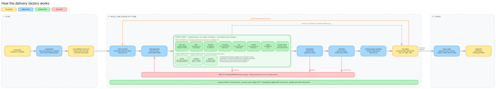
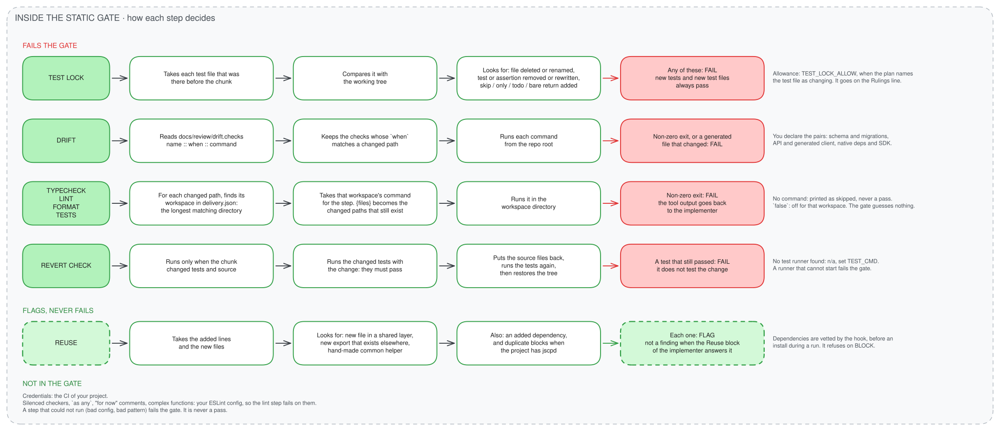

# delivery-skills

Claude Code skills for building with subagents while you stay the one who
accepts the code. You bring the idea and make the decisions. Agents turn it
into a plan, build one small chunk at a time, and stop so you can read the
diff. Nothing is committed for you.

| Who | Does |
| --- | --- |
| You | The idea, every decision, the final read of each diff |
| Agents | Edge cases as questions, the code, a first review, running the change |
| Scripts | Everything that has one right answer |

## Install

```
/plugin marketplace add vilkoalexander/delivery-skills
/plugin install delivery-skills@vilkoalexander
```

Skills show up as `delivery-skills:<name>`. Start a run by asking for a plan
to be built in chunks.

## A run

1. **Answer the questions.** Every decision the plan made without you comes
   back numbered, with a recommended answer. Facts the agent can look up, it
   looks up.
2. **Approve the cut.** Chunks you can read in one sitting, each with a risk
   class, the criteria it completes and the one request or tap that proves it.
3. **A chunk is built.** One agent writes the tests from the criteria and
   sees them fail. A different agent writes the code and cannot edit those
   tests. When the two do not agree, the controller decides from the plan
   which side is wrong. Scripts check the result. Then a reviewer reads it
   against the rubrics and a verifier runs it. Failures go back, up to a cap.
4. **Read the report and the diff.** Which files need a close read, what was
   run, what was fixed, what was left. Say `next`, `fix <thing>`, `redo` or
   `stop`.
5. **After the last chunk** the whole tree is verified against every
   acceptance criterion, reviewed, then read by a second model family.

Agent review is a filter inside the build loop. Your read is the acceptance.

[](diagrams/delivery-factory.svg)

The picture is wide: click it for full size.

## Scripts decide what they can

A rule in a prompt is a request. A script gives the same answer every run
and costs no tokens. So anything with one right answer is a script, and a
model is asked only what is left. A script that cannot answer says so and
fails; it never reports "nothing found" for something it could not look at.

[](diagrams/static-gate.svg)

| Script | Decides | Runs |
| --- | --- | --- |
| `hooks/guard.sh` | During a run git is read-only on the command line: no commit, add, push, merge, stash or PR, and no install of a package the registry does not vouch for. It reads the command text, so it stops mistakes, not a script written to get around it. Reviewer and verifier cannot write. An implementer report has its Proof block. A chunk task completes only after your decision is in the run log. | On every tool call |
| `delivery-pipeline/scripts/static-gate.sh check` | The commands your `docs/review/delivery.json` names for typecheck, lint, format and tests pass; a step with no command is reported as skipped, and a step that could not run fails the gate | After each chunk, before any reviewer |
| `test-review/scripts/test-lock.sh` | No existing test was deleted, skipped or had an assertion rewritten | In the gate |
| `delivery-pipeline/scripts/drift.sh` | Two copies of one fact still agree: schema and migrations, API and generated client, native deps and SDK. You declare the pairs. | In the gate, when a matching path changed |
| `test-review/scripts/revert-check.sh` | New tests pass with the change and fail when it is reverted | In the gate, when tests and source changed |
| `reuse-guardrails/scripts/reuse-scan.sh` | A new helper, export or dependency duplicates one the repo has | In the gate; flags, never fails |
| `delivery-pipeline/scripts/dep-vet.sh` | A package exists in the registry, is not days old and is not reported as malware; flags install scripts and known advisories | In the hook before an install or `npx` during a run |
| `delivery-pipeline/scripts/risk.sh` | Risk class of a change, from its paths; says when a dependency change shares the chunk with other work | At the cut and in each report |
| `<rubric>/scripts/scan.sh` | Mechanical smells in one file | Before a reviewer reads it |
| `<rubric>/scripts/inventory.sh` | What the repo already has to reuse | Before an implementer writes |
| `chunked-delivery/scripts/snapshot.sh` | Nothing: records the working tree before a chunk and writes the diff of that chunk alone, without touching the index | Before and after each chunk |
| `chunked-delivery/scripts/redo.sh` | Returns the tree to before a chunk, keeps what it discards as a patch | On `redo` |
| `hooks/tree-check.sh` | A reviewer or verifier seat left the working tree as it found it; a seat that wrote is refused once, then recorded | When a read-only seat starts and stops |
| `hooks/emit.sh` | Nothing: records every tool call, agent start and stop, and refusal of a run, in the background | On every tool call during a run |
| `chunked-delivery/scripts/mark.sh` | Whether the next step of the loop is permitted: the order of phases, the fix-round limit of the risk class, a verify before the report, your answer before the next chunk. `lifecycle.mjs` holds the rules, and the floor page, the log and the retro read the same file | At each step of the loop |
| `chunked-delivery/scripts/run-log.sh` | One line per chunk; `stats` totals what each gate caught and counts the paths the runs took | At each decision |
| `chunked-delivery/scripts/test-first.sh` | A test author changed a file that is not a test; an implementer changed a test | After the test authors, and after the implementers |
| `run-retro/scripts/sources.sh` | What one run left behind: chunks, decisions, what you typed, refusals, gate failures, transcript paths | At the start of a retro |
| `delivery-pipeline/scripts/stamp.sh` | Which project-layer documents name code that changed since the commit on their `As of:` line; `set` writes the commit | After the recipe is proved, and at the cut; flags, never fails |
| `verify-recipe/scripts/check.sh` | The verify recipe and the feature map are whole: every section filled, every feature in the index, no placeholder, no path that is gone | After the recipe is written, and at the cut |
| `comment-cleanup/scripts/verify.sh` | A cleanup changed comment lines only | After a comment cleanup |

The gate has no scan for credentials, suppressions or complexity: CI owns
credentials, and the project's ESLint config owns the other two
([`STATIC-SETUP.md`](skills/delivery-pipeline/STATIC-SETUP.md) has the rules).

The hook reads commands through `hooks/command.mjs`, a tokenizer and not a
shell: pip, pipx and uvx installs are not vetted, and a seat writes only
under a temp directory or `DELIVERY_EVIDENCE_DIR`.

Paths are under `skills/`. Outside a run the hook does nothing, so other
plugins that commit keep working. Every script has tests;
`bash scripts/test.sh` runs them all, as CI does, and `bash scripts/test.sh risk`
runs the ones whose path contains a word.

No script decides whether the design is right or the code will age well. That
is the reviewer's first pass and then yours, which is why chunks are small.

## Risk class

Risk comes from what a change touches, not how hard it looks.

| Class | Touches | Implementer | Review | Verify | Fix rounds | Second model |
| --- | --- | --- | --- | --- | --- | --- |
| low | feature-local UI, tests, docs | Haiku | none | none | 0 | no |
| medium | services, shared helpers, data fetching | Haiku or Sonnet | Sonnet | Sonnet | 3 | no |
| high | schema, auth, money, shared contracts | Opus | Opus | Sonnet | 5 | yes |

Low-risk chunks pass the scripts and go straight to you. The last fix round
goes to the next model up.

## Skills

| Skill | Does |
| --- | --- |
| `chunked-delivery` | The run, in one file in run order: preflight, the loop, the model for each role, what each risk class gets, the reports. One reference file for each phase and for each thing only some runs need. |
| `review-routing` | Maps changed files to rubrics; merges findings into one list. |
| `react-review`, `angular-review`, `nestjs-service-review`, `prisma-schema-review`, `spring-service-review`, `jpa-schema-review`, `api-contract-review`, `test-review`, `observability-review`, `security-review` | Review rubrics, one kind of file each: a checklist, a list of things not to report, a scan script and an inventory script. |
| `react-screen-authoring` | Read before a new screen is written. |
| `comment-cleanup` | Removes comments a reader does not need. |
| `reuse-guardrails` | Audits whether the project stops agents rewriting what already exists. |
| `memory-dash` | Dashboard and audit of Claude Code auto-memory across projects. |
| `verify-recipe` | Writes how an agent starts the app, drives it and shows what happened, and a feature map with one file per feature. The verifier reads both and does not rediscover the project each chunk. |
| `run-retro` | Looks back at one run: what you had to fix or decide late, and the check, rubric line or glossary term that prevents it next time. |
| `factory-floor` | Local page that shows a run live: stations, gate steps, agents, tokens, refusals. |

Three agents come along: `reviewer` and `verifier` (read-only) and
`oneway-implementer`. The pipeline dispatches them. More diagrams in
[`diagrams/`](diagrams).

A `SKILL.md` holds what every use of the skill needs. What only some uses
need is in a file next to it (`references/`, `CHECKLIST.md`) and
is read when its condition is true. `bash scripts/token-budget.sh` shows the
cost of each. `skills/delivery-pipeline/` holds the scripts of the gate and
has no skill of its own.

## Your project

- Say what the gate runs: `bash skills/delivery-pipeline/scripts/static-gate.sh init`
  drafts `docs/review/delivery.json` from your `package.json` files and your
  Gradle or Maven build: the stack,
  one command per static step per workspace, and your own risk, secret,
  dependency and shared-layer patterns. Correct it and commit it. The gate
  runs what it names and refuses to run without it. Example in
  [`templates/delivery.json`](templates/delivery.json).
- A run writes to you in ASD-STE100 Simplified Technical English: short
  sentences, one instruction each, active voice, one word for one thing. Code
  and tool output stay as they are. `"writing": "free"` in the same file sets
  it off.
- Tell the rubrics about your codebase: one file per rubric at
  `docs/review/<rubric>.md`. Starting points in [`templates/`](templates/README.md).
- Write the verify recipe once: ask for one and the `verify-recipe` skill
  writes `docs/review/verify.md` (launch, doctor, drive, evidence, cleanup)
  and `docs/review/features/`, then proves them by running one feature.
  Starting points in [`templates/verify.md`](templates/verify.md) and
  [`templates/verify-feature.md`](templates/verify-feature.md).
- `bash skills/delivery-pipeline/scripts/static-gate.sh coverage` lists which
  analyzers you enforce and which you lack. What lint enforces never reaches
  a reviewer.
- Declare your drift checks in `docs/review/drift.checks`, one line each;
  start from [`templates/drift.checks`](templates/drift.checks). `coverage`
  names the pairs you have and do not check.
- `bash skills/reuse-guardrails/scripts/audit.sh <repo>` lists which of the
  thirteen reuse guardrails you have.
- `bash skills/chunked-delivery/scripts/run-log.sh stats` shows what the
  static gate, review and you each caught, per risk class. Below that it
  counts, from the event files, the chunks that got to each phase, the fix
  rounds of each chunk, and the runs and failures of each gate step.
  Each log line carries the plugin version, and the last table of the log
  counts by version: defects that you found and chunks that you rejected
  should fall after a change to a gate or a rubric.
- `node skills/factory-floor/scripts/serve.ts --open` shows runs live on
  a local page. It reads event files and transcripts; nothing leaves the machine.
- `bash scripts/token-budget.sh` shows what each dispatch loads.
- Set `CLAUDE_CODE_ENABLE_TODO_TOOLS=1` to see the chunks of a run in the
  task list of Claude Code. Without it the run works the same.
- Set `TYPESAFE_API_KEY` and `risk.sh` classifies from the diff content, not
  only from paths. Classes are only ever raised.

## License

MIT
